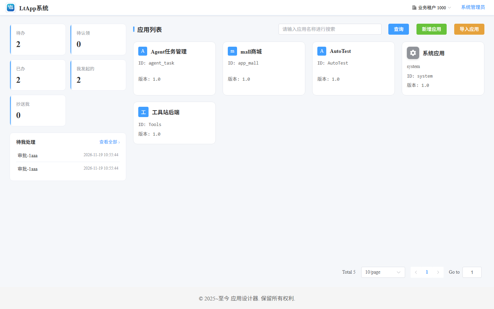
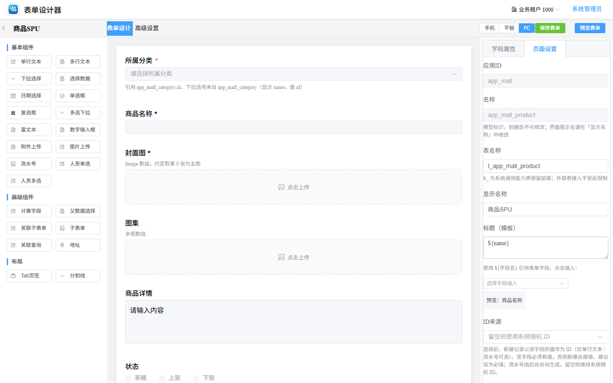
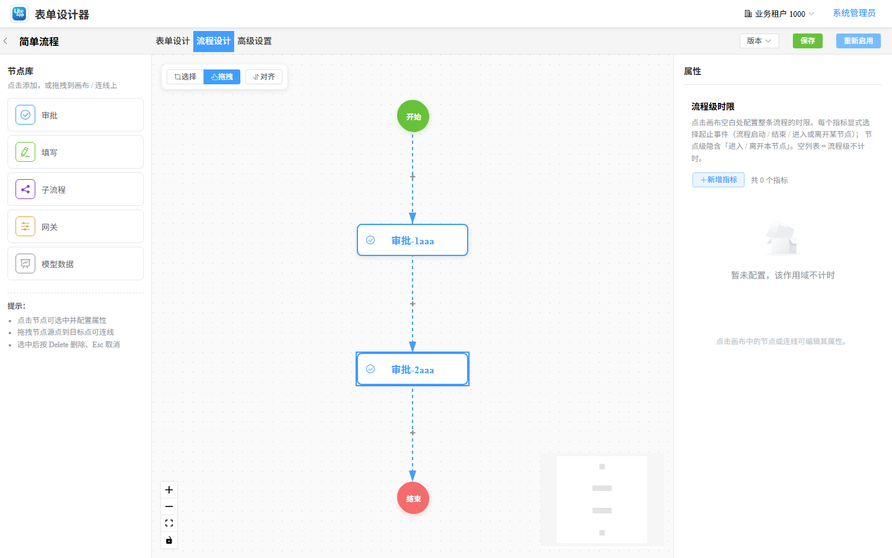
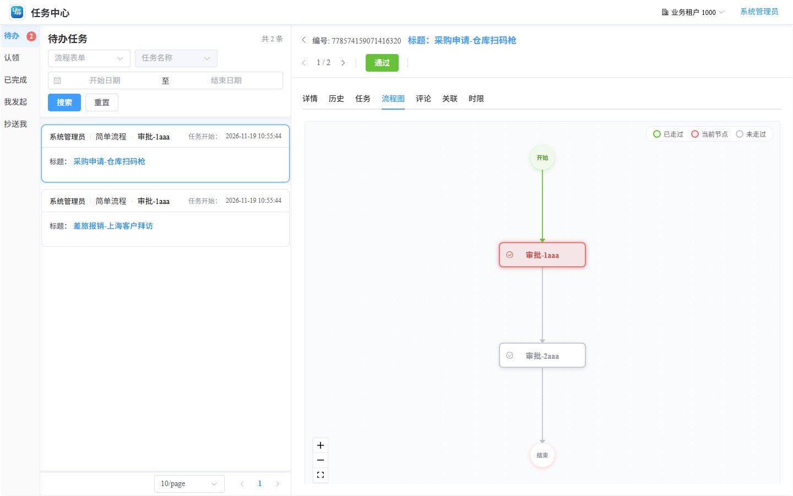

# lt-app

**An open-source no-code platform: turn forms, workflows, pages and cross-table data into a business system that actually ships.**

One `docker compose up` and you are in. Self-hosted, multi-tenant, and the schema stays in your own database.

[Quick Start](#quick-start) · [Features](#features) · [Build from Source](#build-from-source) · [中文](./README.md)



## Why lt-app

Most enterprise work is not blocked by code — it is blocked by spreadsheets held together with chat messages: expense claims, purchasing, stock-in, invoicing, equipment inspections, customer ledgers. SaaS usually fails on two points: the data must live in your own data center, and the business team always needs changes faster than the vendor's release cycle.

lt-app is built for that layer:

- **Business users change it themselves.** Fields, validation, approval nodes, list columns, mobile entry points are all configuration, not releases.
- **One model covers collect → route → analyze.** Data collected from a form flows straight into an approval process, then into views and aggregate tables. No export/import dance.
- **Self-hosted and multi-tenant.** A single instance can serve several business units with isolated schemas, orgs, roles and permissions.
- **Not a demo.** The bundled mall app (products, SKUs, orders, inventory, payment, after-sales) and the tools backend run on this platform.

Typical scenarios: expense/purchase/contract approval, order fulfilment and inventory, customer and asset ledgers, external data collection via shared forms and QR codes, and department portals.

## Quick Start

Requirements: Docker 20.10+ and Docker Compose. MySQL 8 is provided by the compose file.

```bash
git clone https://gitee.com/rocket3/lt-app.git
cd lt-app/docker
docker compose up -d
```

Wait until the backend is healthy (first start creates the schemas, usually 1–2 minutes):

```bash
docker compose ps
docker compose logs -f lt-app-backend
```

Open <http://localhost/ltapp/> and log in with `admin` / `12345678` (change it after the first login).

Data is persisted under `docker/`: `mysql_data/` (database), `logs/` (app + nginx), `file/` (attachments). Back up those three directories.

If port `80` or `8088` is already taken by a local dev server, remap the ports in `docker-compose.yml` (e.g. `8080:80`, `18088:8088`) and use <http://localhost:8080/ltapp/>.

## Features

- **Form & data modeling** — text, textarea, rich text, number, select, radio, checkbox, date/time, image, file, address, tabs, divider, user/department pickers, sub-form, parent-child related query, formula, serial number — 20+ built-in field types. Drag to lay out, configure on the right, separate PC and mobile layouts.
- **Views & data shaping** — grid (inline editing, quick-filter chips, batch update), kanban, gallery, hierarchy, gantt, dependency views; multi-table joined views with computed fields and per-view permissions; aggregate tables (dimension + metric) so list queries don't join at runtime.
- **Workflow** — BPMN-style designer with approval, task, sub-process, gateway and model-data nodes; or-sign / countersign, add-assignee, CC, time limits; process bound to a form, tasks land in the personal task center with a replayable flow chart.
- **Pages & portals** — drag-and-drop page designer to compose navigation, lists, charts, form containers, carousels into mobile/PC pages that act as app entry points.
- **Platform** — multi-tenant schemas, org/role/permission management, audit log, REST APIs with scoped session tokens, app import/export, Quartz jobs, mail / WeCom / WeChat message connectors, WeChat mini-program login and payment.







Stack:

| Layer | What it uses |
| --- | --- |
| Backend | Java 17 (JDK 21 in the image) · Spring Boot 4.0 · Flowable 8 (BPMN engine) · MyBatis + PageHelper · MySQL 8 · Sa-Token (auth) · Quartz (scheduling) |
| Frontend | Vue 3.5 · Vite 5 · Element Plus · Vue Flow (process/dependency graphs) · ECharts 6 (charts) · TipTap 3 (rich text) |
| Modules | `lt-app-runtime` model & runtime · `lt-app-studio` design-time & API · `lt-app-system` users/tenants/permissions · `lt-app-auth` auth · `lt-app-connector` external systems |

Models, views and process definitions are metadata stored in the database, so moving an app between environments is an import/export, not a code change.

## Build from Source

Just want to run the system? Use [Quick Start](#quick-start) — no local build needed. To change backend Java or frontend code and produce your own images, see below. Full guide: **[docker/README.md](./docker/README.md)**.

**Prerequisites**

| Tool | Version | Used for |
| --- | --- | --- |
| Java JDK | 17+ (21 recommended) | Backend compile |
| Maven | 3.6+ | Backend jar |
| Node.js | 18+ | Frontend build |
| pnpm | 9+ (project pins `10.25.0`) | Frontend build |
| Docker | 20.10+ (with compose plugin) | Build / push images |

On a fresh machine, run the preflight check first (validates JAVA_HOME, versions, Docker daemon; auto-fixes CRLF; prints install commands for anything missing):

```bash
cd docker && bash pre_install.sh          # Linux / WSL / Git Bash
# Windows PowerShell: .\pre_install.ps1
```

Once all green, build the backend jar + frontend dist + both images in one step:

```bash
./build-docker.sh                         # Windows: .\build-docker.ps1
```

To share your build, push to CCR:

```bash
bash push-ccr.sh                          # studio + designer
```

## Resources

- Repository: <https://gitee.com/rocket3/lt-app>
- Issues: <https://gitee.com/rocket3/lt-app/issues>
- Screenshots: [`docs/images`](./docs/images)
- License: Apache-2.0

## Contributing

1. Fork the repository and branch from `master` (`feat_xxx` / `fix_xxx`).
2. Make sure `mvn -pl lt-app-studio -am clean package -DskipTests` and `pnpm build` pass.
3. In the PR, describe the motivation, the blast radius, and how you verified it (screenshot or API response).
