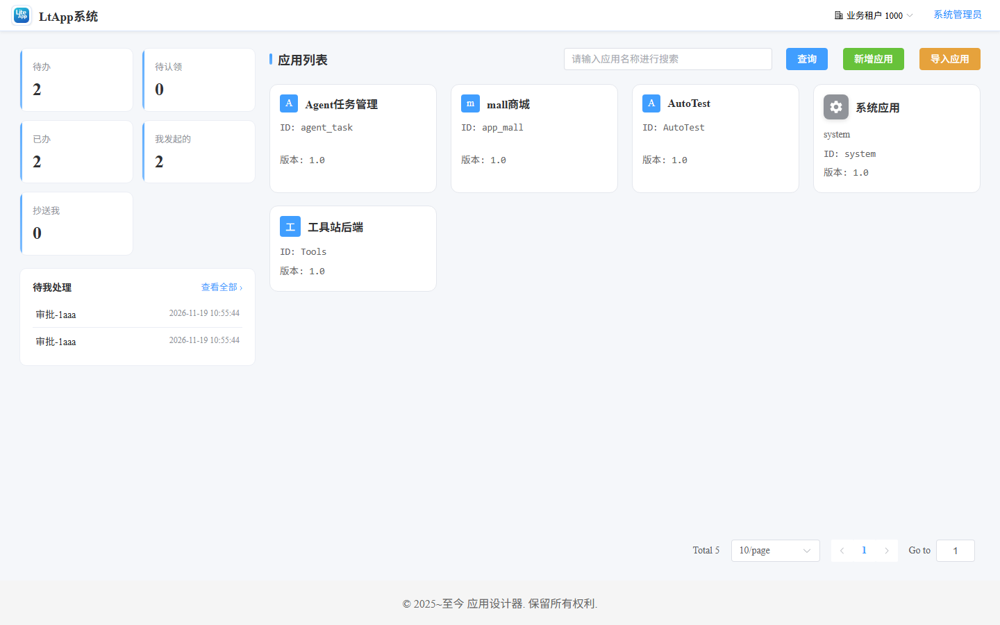
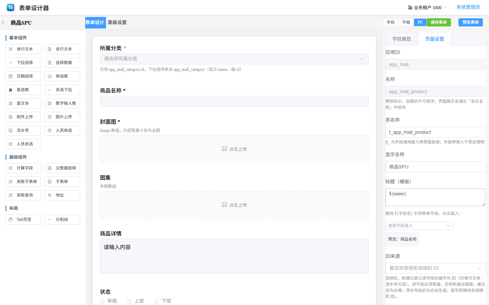
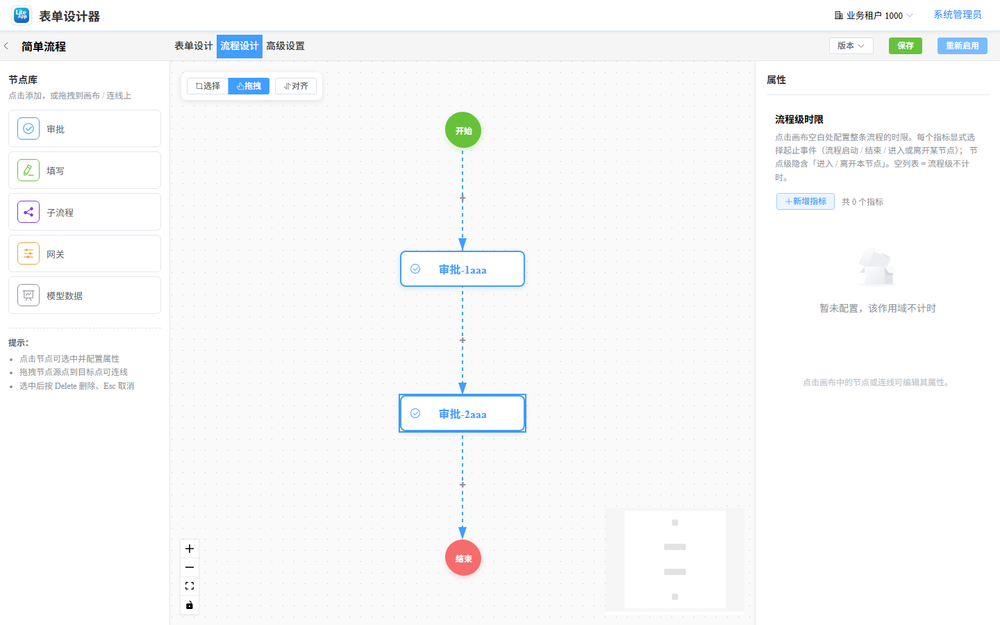
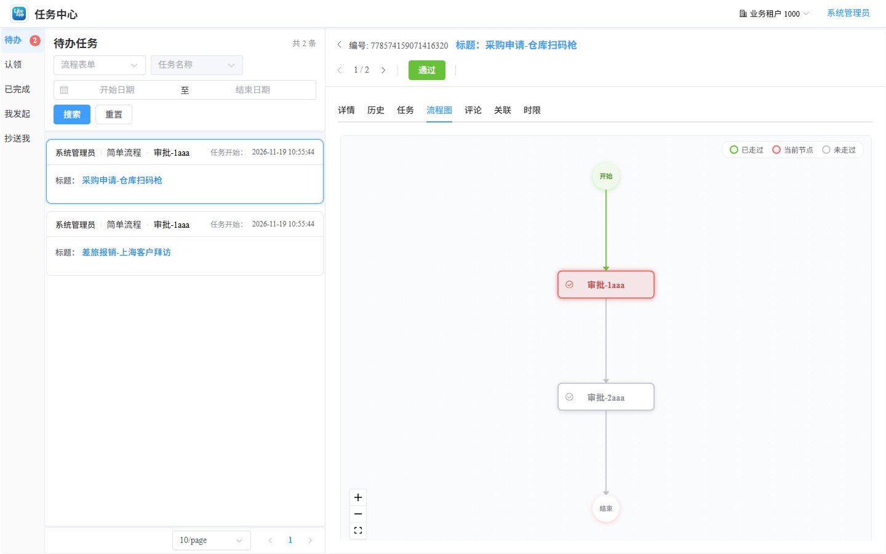
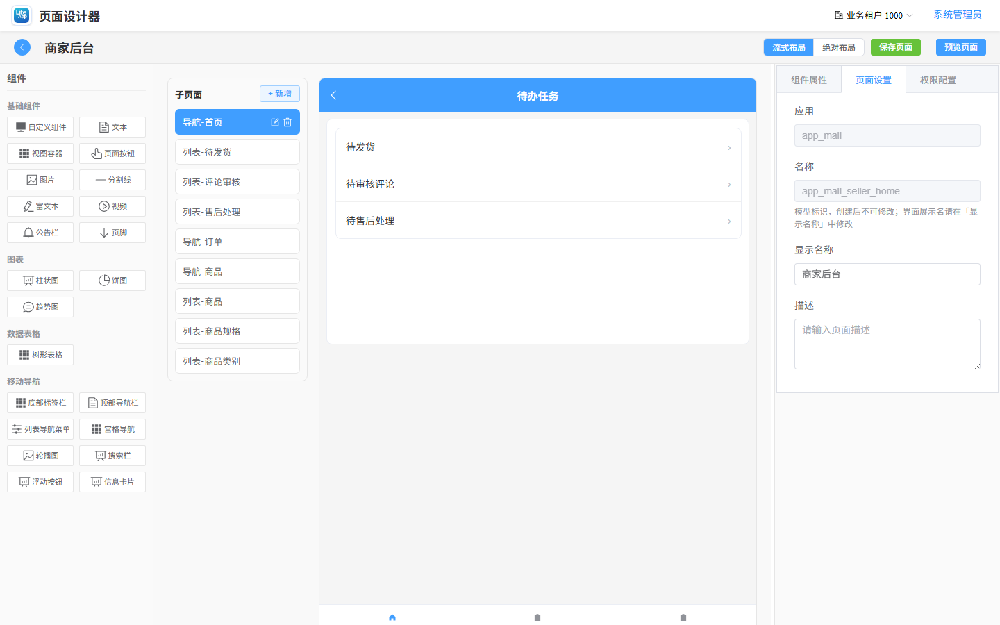

# lt-app

**开源的零代码平台：把表单、流程、页面和多表数据配置成一个能上线的业务系统。**

一条命令拉起 Docker 环境，打开浏览器就能建应用。私有化部署，多租户隔离，代码和数据结构都在你自己手里。

[快速开始](#快速开始) · [功能介绍](#功能介绍) · [开发构建](#开发构建) · [官网与资料](#官网与资料) · [English](./README.en.md)



## 价值与场景

企业里最磨人的活，往往不是写代码，是那些"用 Excel 管着、靠群里催着"的流程：报销、采购、入库、开票、设备巡检、客户台账。买 SaaS 又常常卡在两件事上——数据要放在自己机房，以及业务部门的需求永远比厂商排期快。

lt-app 解决的就是这一层：

- **业务人员自己改**。字段、校验、审批节点、列表列、手机端入口，都是配置项，不用等版本发布。
- **一套模型跑完 采集 → 流转 → 分析**。表单收集的数据直接做流程流转，再进视图和聚合表出数，不搬家、不对账。
- **能私有化，也能一套服务多组织**。多租户 + 用户/组织/角色权限，集团下不同业务单元各自建应用、数据互相隔离。
- **不是玩具**。镜像里自带的商城应用（商品、SKU、订单、库存、支付、售后）和工具站后台，就是按这套能力配出来的完整系统，不是一张截图。

典型落地场景：

| 场景 | 平台里怎么做 |
| --- | --- |
| 费用报销、采购申请、合同会签 | 流程表单 + 审批节点 + 或签/会签 + 抄送 + 时限 |
| 进销存、订单履约 | 商品/订单/库存多表单关联，聚合表算可用库存，视图做对账 |
| 客户台账、设备巡检 | 表单 + 关联查询 + 移动端填报 + 二维码分享 |
| 对外数据收集 | 表单生成分享页/二维码，外部人员免登录填报，权限可控 |
| 部门业务门户 | 页面设计器拖出导航、列表、图表、表单入口，一个应用一个门户 |

## 快速开始

依赖只有 Docker（20.10+）和 Docker Compose。默认用官方 MySQL 8 镜像，无需自己装数据库。

```bash
git clone https://gitee.com/rocket3/lt-app.git
cd lt-app/docker
docker compose up -d
```

等后端变健康（首次启动会建库建表，通常 1~2 分钟）：

```bash
docker compose ps                      # 三个容器都 Up / healthy 即可
docker compose logs -f lt-app-backend  # 看到 db-init 完成、Started ... 就是起来了
```

然后打开浏览器：

- 管理端 <http://localhost/ltapp/>
- 初始账号 `admin`，密码 `12345678`（登录后请在个人设置里改掉）

首次跑起来的样子：

- 应用中心可以看到几个示例应用（`mall商城`、`工具站后端`、`AutoTest`、系统应用），点进去就是表单、数据、流程的完整入口。
- 想从头做一个：应用中心 → 新增应用 → 左上角 `+` 建表单 → 拖字段 → 保存 → 预览。

常用运维命令：

```bash
docker compose stop        # 停服务，数据保留
docker compose down        # 删容器，mysql_data/ 里的数据还在
docker compose logs -f     # 看全部日志
```

数据落在 `docker/` 下的 `mysql_data/`（数据库）、`logs/`（应用与 nginx 日志）、`file/`（附件）。备份直接打包这三个目录即可。

**端口被占用怎么办**：如果本机有开发环境占了 `80` 或 `8088`（localhost 有别的程序在跑），容器绑定会失败或访问到旧服务。改 `docker-compose.yml` 里的 `ports`：

```yaml
lt-app-front:
  ports:
    - "8080:80"
lt-app-backend:
  ports:
    - "18088:8088"
```

改完 `docker compose up -d`，访问 `http://localhost:8080/ltapp/`。

## 功能介绍

### 表单与数据建模

内置二十多种字段：单行/多行文本、富文本、数字、下拉、单选、多选、日期时间、图片、附件、地址、标签页、分割线、人员/部门选择、子表单、上下级关联查询、公式计算、流水号。

拖拽排版，右侧配字段属性，同一个表单可以出 PC 和手机两套布局。



### 视图与数据加工

一张表单可以有多个视图，不止是表格：表格（支持行内编辑、快捷筛选 chips、批量更新）、看板、画廊、层级、甘特、依赖关系。列显示、排序、筛选、操作按钮（新增/导入/导出/删除）都按视图配，也能按角色控制。

数据不止一张表：**多表关联视图**把主表和关联表拼成一个列表，支持计算字段和权限配置；**聚合表**按维度+指标预聚合（比如按商品维度算销量、按 SKU 算可用库存），列表查询不用现场连表。数据加工走的是流水线模型（管道/视图/聚合表），配置完即用。

### 流程与审批

用流程设计器连节点：开始 → 审批/填写 → 网关/子流程 → 结束。审批节点可配处理人、或签会签、加签、抄送、超时策略和流程级时限指标。流程直接挂在表单上，提交即发起，任务进个人任务中心。

审批人看到的是带流程图的完整现场：当前走到哪、谁处理过、每步的审批意见和字段变更都能查。





### 页面与应用门户

页面设计器把导航、宫格、列表、图表（柱状/折线/饼图）、表单容器、轮播、公告、文本图片拼成手机端/PC 端页面。页面本身就是一个应用入口，适合做部门门户、商家后台、对外服务页这类"不像表单"的界面。



### 平台能力

- **多租户**：租户库级隔离，租户内再分组织、角色、用户组；菜单与数据权限都按角色下发。
- **审计日志**：登录成功/失败/锁定、登出、越权拒绝、口令变更都留痕，列表可按事件类型筛选。
- **开放能力**：模型数据 REST 接口 + 令牌管理（可给外部系统发限定范围的会话令牌），应用可整包导入/导出。
- **定时任务与消息**：Quartz 定时作业；邮件、企业微信、微信模板消息、小程序登录与微信支付都有现成连接器。

### 技术栈

| 层 | 选型 |
| --- | --- |
| 后端 | Java 17（镜像跑在 JDK 21）· Spring Boot 4.0 · Flowable 8（BPMN 流程引擎）· MyBatis + PageHelper（MySQL 8）· Sa-Token（认证鉴权）· Quartz（定时任务） |
| 前端 | Vue 3 · Vite 5 · Element Plus · Vue Flow（流程图 / 依赖关系图）· ECharts（图表）· TipTap（富文本） |
| 后端模块 | `lt-app-runtime` 模型与运行时 · `lt-app-studio` 设计态与接口 · `lt-app-system` 用户/租户/权限 · `lt-app-auth` 认证 · `lt-app-connector` 外部系统连接 |

模型定义、视图配置、流程定义都是存在库里的**元数据**，可导入导出——换环境迁移应用是"导包"，不是"改代码"。

## 开发构建

只想运行系统？用上面的[快速开始](#快速开始)即可，无需本地构建。要改后端 Java 或前端代码、产出自己的镜像时看这里。完整说明见 **[docker/README.md](./docker/README.md)**。

**依赖工具**

| 工具 | 版本 | 用途 |
| --- | --- | --- |
| Java JDK | 17+（推荐 21） | 编译后端 |
| Maven | 3.6+ | 构建后端 jar |
| Node.js | 18+ | 构建前端 |
| pnpm | 9+（工程锁 `10.25.0`） | 构建前端 |
| Docker | 20.10+（含 compose 插件） | 构建 / 推送镜像 |

全新机器先跑前置检测（校验 JAVA_HOME、版本、Docker daemon，自动修 CRLF，缺失项给安装命令）：

```bash
cd docker && bash pre_install.sh          # Linux / WSL / Git Bash
# 或 Windows PowerShell: .\pre_install.ps1
```

全绿后一键构建后端 jar + 前端 dist + 两个镜像：

```bash
./build-docker.sh                         # Windows: .\build-docker.ps1
```

改完代码要给别人用，推送到 CCR：

```bash
bash push-ccr.sh                          # studio + designer 两个镜像
```

## 官网与资料

- 代码仓库：<https://gitee.com/rocket3/lt-app>
- 问题反馈：<https://gitee.com/rocket3/lt-app/issues>
- 界面截图：[`docs/images`](./docs/images)
- 许可证：Apache-2.0，可商用、可私有化二次开发

如果这个项目对你有用，欢迎 Star，也欢迎提 Issue 说清楚场景——比"求支持"更有用的是你卡在哪一步。

## 参与贡献

1. Fork 仓库，基于 `master` 拉分支（`feat_xxx` / `fix_xxx`）
2. 部署编排改动请在 `docker/` 下实际跑一次 `docker compose up -d`，确认三个容器 healthy
3. 提交 PR 时说明改动动机、影响范围和验证方式（截图、日志或接口返回）
